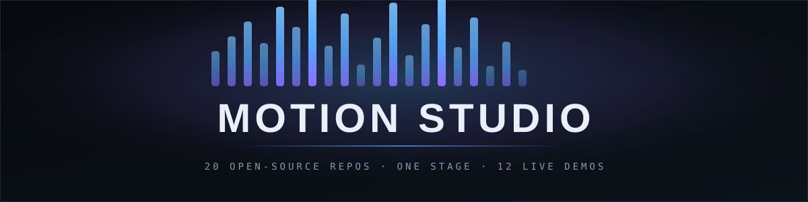
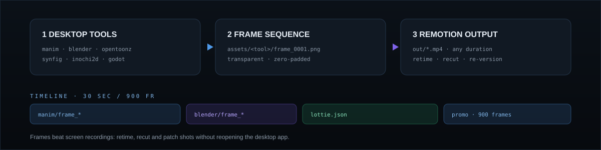

<div align="center">
  
</div>

<h3 align="center">Build motion in the browser. Ship the film from one timeline.</h3>

<p align="center">
  <a href="https://github.com/scat2020/Motion-Studio/stargazers"></a>
  
  
  
  
</p>

<p align="center">
  <b>English</b> · <a href="README.zh-CN.md">简体中文</a>
</p>

---

**Motion Studio** is not twenty demos sitting in twenty folders. It is twenty open-source motion
repositories arranged into one pipeline that actually ships:

```
idea → keyframes → motion → polish → render
```

- **Browser stage — 12 tools running live.** Change a number, see the new rhythm immediately. This is
  where you dial in *feel*: stagger, easing, spring stiffness.
- **Desktop pipeline — 8 tools, one command each.** Manim, Blender, OpenToonz, Synfig, Inochi2D,
  Godot, Motion Canvas and Remotion take the work that only a real renderer can do: hand-drawn
  sequences, rigged characters, 3D, math animation, frame-accurate compositing.
- **Assembly line.** Every tool writes to the same convention, `assets/<tool>/frame_0001.png`, and
  `remotion-starter/` puts all of it on one timeline.

The rule that makes the whole thing work: **frame sequences before screen recordings.** A PNG sequence
can be retimed, recut, extended and patched inside Remotion — without reopening the desktop app.

## ✨ Highlights

| | |
|---|---|
| 🎛 **Live parameter tuning** | 12 real libraries — Anime.js, Motion, React Spring, mo.js, KUTE.js, AnimXYZ, Lottie, Rive, Flubber, Three.js, Matter.js, tsParticles — each with a working demo, not a screenshot. |
| 🧾 **Copy-paste source** | Every card carries a minimal runnable snippet (`看代码`) and a copy button. What you tune is what you paste into your edit. |
| 🧭 **Honest capability boundaries** | Each of the 20 cards states what that tool is actually good at, plus the exact install and render commands. |
| 🎬 **A real render stage** | `remotion-starter/` is a working Remotion project (not a doc): a 3-second title and a 30-second promo, both addressable by frame. |
| 📦 **Single-file build** | `npm run build` emits one `dist/index.html` (~2.5 MB, 680 KB gzipped) that runs offline — no server, no CDN. |
| 🔍 **Headless verification** | `scripts/` drives headless Chrome to screenshot the page, collect `pageerror`s and probe every canvas. |

<div align="center">
  
</div>

## ⚡ Quick start

```bash
git clone https://github.com/scat2020/Motion-Studio.git
cd Motion-Studio
npm install
npm run dev        # http://localhost:5173
npm run build      # → dist/index.html, one file, double-click to open
```

Then render something with it:

```bash
cd remotion-starter
npm install
npm run dev                                   # Remotion Studio preview
npm run render                                # → out/title.mp4 (3s title, 1920×1080)
npx remotion render Promo out/promo.mp4       # → 30s promo, 900 frames
```

> The first Remotion render downloads headless Chromium (~150 MB) once.

## 🧩 The 20 tools

`LIVE` runs in the browser stage today. `PIPELINE` is a desktop/heavy renderer wired to the assembly
line — the card gives you commands and a minimal scene, the tool itself is your choice to install.

| # | Tool | Role in the studio | Runtime |
|---|---|---|---|
| 01 | [Remotion](https://github.com/remotion-dev/skills) | Assembly: frame-addressable React video, the line everything lands on | `PIPELINE` |
| 02 | [Anime.js](https://github.com/juliangarnier/anime) | Rhythm: staggered entrances, equalizers, looping beats | `LIVE` |
| 03 | [Motion](https://github.com/motiondivision/motion) | Layout transitions: list reorder, panel expand | `LIVE` |
| 04 | [React Spring](https://github.com/pmndrs/react-spring) | Hand-following physics: drag, trails, springy entrances | `LIVE` |
| 05 | [Motion Canvas](https://github.com/motion-canvas/motion-canvas) | Code animation: explainers, diagrams, sentence-level captions | `PIPELINE` |
| 06 | [Manim](https://github.com/ManimCommunity/manim) | Math visualization: formulas, axes, geometric proofs | `PIPELINE` |
| 07 | [mo.js](https://github.com/mojs/mojs) | Instant bursts: tap feedback, success pops | `LIVE` |
| 08 | [Flubber](https://github.com/veltman/flubber) | SVG morphing: icon to icon, shape to shape | `LIVE` |
| 09 | [KUTE.js](https://github.com/thednp/kute.js) | Lightweight tweening: SVG attributes, CSS transforms | `LIVE` |
| 10 | [AnimXYZ](https://github.com/ingram-projects/animxyz) | CSS choreography: zero-runtime entrances | `LIVE` |
| 11 | [Lottie Web](https://github.com/airbnb/lottie-web) | Vector illustration playback: AE → JSON | `LIVE` |
| 12 | [Rive Runtime](https://github.com/rive-app/rive-wasm) | State-machine characters: interactive, input-driven | `LIVE` |
| 13 | [Inochi2D](https://github.com/Inochi2D/inochi2d) | 2D puppets: blink, mouth, face rigs | `PIPELINE` |
| 14 | [OpenToonz](https://github.com/opentoonz/opentoonz) | Hand-drawn passages: line art, coloring, exposure sheet | `PIPELINE` |
| 15 | [Synfig](https://github.com/synfig/synfig) | Vector tweening: flat-style transitions, looping backgrounds | `PIPELINE` |
| 16 | [Blender](https://github.com/blender/blender) | 3D characters: rigging, walk cycles, render passes | `PIPELINE` |
| 17 | [Three.js](https://github.com/mrdoob/three.js) | Real-time 3D: product spins, spatial backgrounds | `LIVE` |
| 18 | [Godot](https://github.com/godotengine/godot) | Interactive prototypes: state machines + Movie Maker capture | `PIPELINE` |
| 19 | [Matter.js](https://github.com/liabru/matter-js) | 2D rigid bodies: drops, collisions, stacking | `LIVE` |
| 20 | [tsParticles](https://github.com/tsparticles/tsparticles) | Particle atmosphere: links, attraction, pointer reaction | `LIVE` |

## 🎬 Three workflows you can copy

**A. A 15-second opener — browser + Remotion only**

1. Tune the feel in the LIVE area: Anime.js for stagger cadence, Motion for layout transitions.
2. Paste those numbers into `remotion-starter/src/StudioTitle.tsx` — `spring()` and `interpolate()`.
3. Drop a tsParticles config into an `<AbsoluteFill>`; it is just React.
4. `cd remotion-starter && npm run render`.

**B. Icon / shape transitions — Flubber + Remotion**

```tsx
import { interpolate } from 'flubber';
const mix = interpolate(playPath, pausePath, { maxSegmentLength: 2 });

// Inside Remotion the interpolation is frame-addressable and re-orderable
const d = mix(interpolate(frame, [0, 24], [0, 1], { extrapolateRight: 'clamp' }));
```

**C. Hand-drawn or character passages — desktop tool → sequence → assembly**

1. Export a PNG sequence from OpenToonz or Inochi2D (transparent background, zero-padded names).
2. Drop it into `assets/<tool>/frame_0001.png`.
3. Read frames inside Remotion:

```tsx

```

## 🗂 Project structure

```
Motion-Studio/
├─ src/
│  ├─ App.jsx             # stage shell: sidebar, groups, search
│  ├─ registry.jsx        # the 20 tools: metadata, snippets, pipeline commands ← edit here
│  ├─ components.jsx      # cards, code blocks, error boundaries
│  ├─ demos/dom.jsx       # Anime.js · Motion · React Spring · mo.js · KUTE · AnimXYZ
│  ├─ demos/svg.jsx       # Flubber · Lottie · Rive
│  └─ demos/canvas.jsx    # Three.js · Matter.js · tsParticles
├─ remotion-starter/      # a real Remotion project (own npm package)
│  └─ src/                # StudioTitle.tsx (3s) · Promo.tsx (30s, six scenes)
├─ scripts/               # headless-Chrome verification + promo asset capture
├─ assets/                # convention: desktop-tool output lands here, for the assembly line
└─ docs/                  # README artwork (pure SVG, no binaries)
```

## 🎥 Rendering the 30-second promo

`remotion-starter/src/Promo.tsx` is a six-scene, 900-frame composition built entirely from the
studio's own material:

| Frames | Scene |
|---|---|
| 0–90 | 20 bars rise, then collapse into one gradient rule — the 20 repos becoming one pipeline |
| 90–270 | Title, three group chips (orchestration / primitives / shape & simulation) |
| 270–450 | The real UI: push-in on the hero, cross to the LIVE area, captions on a black band |
| 450–630 | Tutorial in three beats: tune a parameter → copy the source → drop frames into the assembly |
| 630–780 | Pipeline diagram with growing arrows, then a four-clip timeline |
| 780–900 | End card: wordmark, repo path, three entry points |

Specs: `1920×1080` · `30 fps` · `900 frames` · H.264 · burned-in captions, no audio track.

```bash
npx remotion still Promo out/check.png --frame=600   # verify a single frame first
npx remotion render Promo out/promo.mp4 --codec=h264
```

## 🛠 Add your own tool

1. Write a component in `src/demos/<group>.jsx` — start the animation in `useEffect`, clean it up on
   unmount.
2. Add one entry to `src/registry.jsx`:
   `{ id, no, name, group, kind: 'live', Component, desc, code, stage }`.
3. Only has CLI output? Use `kind: 'pipe'` with `steps: [{ title, lang, code }]`.
4. `npm run build` to regenerate the single file.

## ⚠️ Known limitations

- **Rive** loads the official sample `cdn.rive.app/animations/vehicles.riv`; offline it shows a
  hint. Swap in your own `.riv` under `assets/` for a fully offline demo.
- **Three.js / Matter.js / tsParticles** need WebGL or Canvas 2D — remote desktops and very old GPUs
  may degrade.
- **mo.js** is a 1.x package that injects its own SVG into the parent container; for a fully
  controlled React tree, wrap `@mojs/core` yourself.
- **`svg-path-commander` must stay pinned at `2.1.11`** — `kute.js@2.2.6` imports `splitPath`, which
  2.3.5 no longer exports.
- **Remotion** is a separate `npm install`; the first render downloads headless Chromium (~150 MB).
- The single-file build is ~2.5 MB because twelve libraries are genuinely bundled. Trim entries in
  `registry.jsx` if you want a lighter page.

## 🤝 Contributing

Issues and PRs are welcome — especially: new tool cards, better demos, and translations of the UI.
Please keep the two promises: *the demo must actually run*, and *the card must state the tool's real
boundary*. If you add a heavy desktop tool, add commands and a minimal scene, not a fake screenshot.

If this saved you a week of setup, a ⭐ helps other motion people find it.

## 📄 License & acknowledgements

The studio code in this repository is provided for learning and demo use. All twenty upstream
projects keep their own licenses — check each repository before commercial use. Full credit goes to
their maintainers; this project only arranges them.
