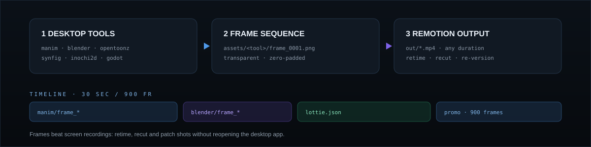

<div align="center">
  
</div>

<h3 align="center">浏览器里调手感，一条时间轴上出片。</h3>

<p align="center">
  <a href="https://github.com/scat2020/Motion-Studio/stargazers"></a>
  
  
  
  
</p>

<p align="center">
  <a href="README.md">English</a> · <b>简体中文</b>
</p>

---

**Motion Studio** 不是把 20 个库各自跑个 demo，而是把它们排成一条真能出货的流水线：

```
想法 → 关键帧 → 运动 → 打磨 → 渲染
```

- **浏览器舞台（12 个工具真跑）**：改一个数字，当场看到新节奏。这一段用来定"手感"——交错、缓动、弹簧刚度。
- **桌面管线（8 个工具，每个一条命令）**：Manim、Blender、OpenToonz、Synfig、Inochi2D、Godot、Motion Canvas、Remotion 承担只有真渲染器才能干的活：手绘序列、绑定角色、3D、数学动画、逐帧合成。
- **总装车间**：所有工具写入同一个约定 `assets/<工具>/frame_0001.png`，再由 `remotion-starter/` 排到同一条时间轴上。

整套方案成立的关键一条：**序列帧优先于录屏**。PNG 序列能在 Remotion 里重排、重剪、补镜头、改时长——不用回桌面软件重导一次。

## ✨ 特点

| | |
|---|---|
| 🎛 **参数当场可调** | 12 个库真装真跑：Anime.js、Motion、React Spring、mo.js、KUTE.js、AnimXYZ、Lottie、Rive、Flubber、Three.js、Matter.js、tsParticles——全是可操作的示例，不是截图。 |
| 🧾 **源码可直接粘贴** | 每张卡片都带最小可运行片段（「看代码」）和复制按钮。你调的那套参数，就是你贴进片子里的那套。 |
| 🧭 **写清能力边界** | 20 张卡明确说明各自擅长什么，加上真实的安装与渲染命令，不吹"万能"。 |
| 🎬 **自带真实渲染台** | `remotion-starter/` 是可用的 Remotion 项目：3 秒片头 + 30 秒宣传片，全部按帧可定址。 |
| 📦 **单文件构建** | `npm run build` 产出一个 `dist/index.html`（约 2.5 MB，gzip 680 KB），离线可用，双击即开。 |
| 🔍 **无头验证脚本** | `scripts/` 用无头 Chrome 截图、收集 `pageerror`、探测每块 canvas 是否真的出画面。 |

<div align="center">
  
</div>

## ⚡ 快速开始

```bash
git clone https://github.com/scat2020/Motion-Studio.git
cd Motion-Studio
npm install
npm run dev        # http://localhost:5173
npm run build      # → dist/index.html，单文件，双击即用
```

用它出一支片子：

```bash
cd remotion-starter
npm install
npm run dev                                   # Remotion Studio 预览
npm run render                                # → out/title.mp4（3 秒片头，1920×1080）
npx remotion render Promo out/promo.mp4       # → 30 秒宣传片，900 帧
```

> 首次渲染会下载一次无头 Chromium（约 150 MB）。

## 🧩 20 个工具的分工

`LIVE` 表示现在就跑在浏览器舞台上；`PIPELINE` 表示桌面或重型渲染器，卡片给你命令与最小场景，装不装由你决定。

| # | 工具 | 在本工作室里的角色 | 运行方式 |
|---|---|---|---|
| 01 | [Remotion](https://github.com/remotion-dev/skills) | 总装车间：按帧排版的 React 视频，所有片段落到这条线上 | `PIPELINE` |
| 02 | [Anime.js](https://github.com/juliangarnier/anime) | 节奏型动效：交错入场、等化器、循环节拍 | `LIVE` |
| 03 | [Motion](https://github.com/motiondivision/motion) | 布局过渡：列表重排、面板展开 | `LIVE` |
| 04 | [React Spring](https://github.com/pmndrs/react-spring) | 跟手物理：拖拽、拖尾、弹入 | `LIVE` |
| 05 | [Motion Canvas](https://github.com/motion-canvas/motion-canvas) | 代码动画：讲解、流程图、逐句字幕 | `PIPELINE` |
| 06 | [Manim](https://github.com/ManimCommunity/manim) | 数学可视化：公式、坐标系、几何证明 | `PIPELINE` |
| 07 | [mo.js](https://github.com/mojs/mojs) | 瞬时爆发：点击反馈、成功动画 | `LIVE` |
| 08 | [Flubber](https://github.com/veltman/flubber) | SVG 形变：图标转图标、形状转形状 | `LIVE` |
| 09 | [KUTE.js](https://github.com/thednp/kute.js) | 轻量补间：SVG 属性、CSS 变换 | `LIVE` |
| 10 | [AnimXYZ](https://github.com/ingram-projects/animxyz) | CSS 编排：零运行时入场 | `LIVE` |
| 11 | [Lottie Web](https://github.com/airbnb/lottie-web) | 矢量插画播放：AE → JSON | `LIVE` |
| 12 | [Rive Runtime](https://github.com/rive-app/rive-wasm) | 状态机角色：可交互、可换输入 | `LIVE` |
| 13 | [Inochi2D](https://github.com/Inochi2D/inochi2d) | 2D 木偶：眨眼、口型、面部驱动 | `PIPELINE` |
| 14 | [OpenToonz](https://github.com/opentoonz/opentoonz) | 手绘段落：描线、上色、摄影表 | `PIPELINE` |
| 15 | [Synfig](https://github.com/synfig/synfig) | 矢量补间：扁平风转场、循环背景 | `PIPELINE` |
| 16 | [Blender](https://github.com/blender/blender) | 3D 角色：绑定、walk cycle、渲染 | `PIPELINE` |
| 17 | [Three.js](https://github.com/mrdoob/three.js) | 实时 3D：产品旋转、空间背景 | `LIVE` |
| 18 | [Godot](https://github.com/godotengine/godot) | 可交互原型：状态机 + Movie Maker 录制 | `PIPELINE` |
| 19 | [Matter.js](https://github.com/liabru/matter-js) | 2D 刚体：掉落、碰撞、堆叠 | `LIVE` |
| 20 | [tsParticles](https://github.com/tsparticles/tsparticles) | 粒子氛围：连线、吸附、鼠标交互 | `LIVE` |

## 🎬 三条能直接照抄的工作流

**A. 15 秒片头——只用浏览器 + Remotion**

1. 在 LIVE 区调手感：Anime.js 定交错节奏，Motion 定布局过渡。
2. 把调好的数字抄进 `remotion-starter/src/StudioTitle.tsx`，用 `spring()` 与 `interpolate()`。
3. 粒子背景用 tsParticles 配置，直接铺在 `<AbsoluteFill>` 里（它就是个 React 组件）。
4. `cd remotion-starter && npm run render`。

**B. 图标 / 形状转场——Flubber + Remotion**

```tsx
import { interpolate } from 'flubber';
const mix = interpolate(playPath, pausePath, { maxSegmentLength: 2 });

// 在 Remotion 里按帧取插值，天然可定址、可重排
const d = mix(interpolate(frame, [0, 24], [0, 1], { extrapolateRight: 'clamp' }));
```

**C. 手绘或角色段落——桌面工具 → 序列帧 → 总装**

1. 从 OpenToonz 或 Inochi2D 导出 PNG 序列（透明底、编号补零）。
2. 放到 `assets/<工具名>/frame_0001.png`。
3. Remotion 里逐帧读：

```tsx

```

## 🗂 目录结构

```
Motion-Studio/
├─ src/
│  ├─ App.jsx             # 舞台骨架：侧栏、分组、搜索
│  ├─ registry.jsx        # 20 个工具的元数据、代码示例、管线命令 ← 改这里
│  ├─ components.jsx      # 卡片 / 代码块 / 错误边界
│  ├─ demos/dom.jsx       # Anime.js · Motion · React Spring · mo.js · KUTE · AnimXYZ
│  ├─ demos/svg.jsx       # Flubber · Lottie · Rive
│  └─ demos/canvas.jsx    # Three.js · Matter.js · tsParticles
├─ remotion-starter/      # 真实的 Remotion 项目（独立 npm 包）
│  └─ src/                # StudioTitle.tsx（3 秒）· Promo.tsx（30 秒六段）
├─ scripts/               # 无头 Chrome 验证 + 宣传片素材抓取
├─ assets/                # 约定：桌面工具产物落这里，供总装引用
└─ docs/                  # README 配图（纯 SVG，无二进制）
```

## 🎥 出那支 30 秒宣传片

`remotion-starter/src/Promo.tsx` 是六段、900 帧的合成，素材全部来自工作室本身：

| 帧区间 | 段落 |
|---|---|
| 0–90 | 20 根竖条升起，收拢成一条渐变横线——20 个仓库合成一条流水线 |
| 90–270 | 标题 + 三组分区胶囊（编排与渲染 / 动效原语 / 形变与模拟） |
| 270–450 | 真实界面：首屏推镜 → 交叉到 LIVE 区，字幕落在底部黑带上 |
| 450–630 | 教程三拍：调参数 → 抄代码 → 丢进总装 |
| 630–780 | 管线示意图（箭头生长）+ 四片段一时间轴 |
| 780–900 | 落版：字标、仓库路径、三个使用入口 |

规格：`1920×1080` · `30 fps` · `900 帧` · H.264 · 纯字幕无音轨。

```bash
npx remotion still Promo out/check.png --frame=600   # 先验单帧
npx remotion render Promo out/promo.mp4 --codec=h264
```

## 🛠 新增一个工具

1. 在 `src/demos/<分类>.jsx` 写组件——`useEffect` 里起动画，卸载时清理。
2. 在 `src/registry.jsx` 加一条：`{ id, no, name, group, kind: 'live', Component, desc, code, stage }`。
3. 只有命令行产物？用 `kind: 'pipe'` + `steps: [{ title, lang, code }]`。
4. `npm run build` 重新出单文件。

## ⚠️ 已知限制

- **Rive** 用官方在线样例 `cdn.rive.app/animations/vehicles.riv`，断网时给提示；换成自己的 `.riv` 放 `assets/` 即可离线。
- **Three.js / Matter.js / tsParticles** 依赖 WebGL 或 Canvas 2D，远程桌面与极老显卡上可能降级。
- **mo.js** 是 1.x 老包，会自己往父容器注入 SVG；要完全受控的 React 树，可自行封装 `@mojs/core`。
- **`svg-path-commander` 必须锁 `2.1.11`**——`kute.js@2.2.6` 从它导入 `splitPath`，2.3.5 已不再导出。
- **Remotion** 需单独 `npm install`；首次渲染下载无头 Chromium（约 150 MB）。
- 单文件约 2.5 MB，因为 12 个库真的都被打了进去；想要更轻，可在 `registry.jsx` 里裁条目。

## 🤝 参与贡献

欢迎 Issue 与 PR，尤其是：新工具卡片、更好的示例、界面文案翻译。请守住两个承诺——**示例必须真的能跑**，**卡片必须写清真实边界**。加重型桌面工具时，给命令和最小场景，不要塞假截图。

如果它替你省下了一周的搭环境时间，点个 ⭐ 能让更多做动效的人找到它。

## 📄 授权与致谢

本仓库的工作室代码供学习与演示使用；20 个上游项目各自保留其许可证，商用前请逐一确认。功劳属于这些项目的维护者——本项目只负责把它们排成一条线。
